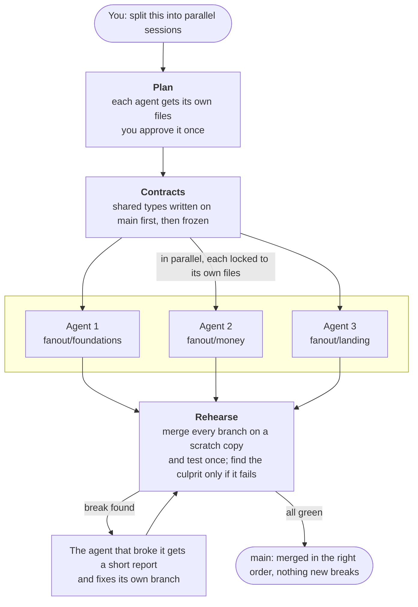

<p align="center">
  <picture>
    <source media="(prefers-color-scheme: dark)" srcset="assets/logo-dark.svg">
    
  </picture>
</p>

<p align="center"><b>Run several coding agents at once. Merge once. Nothing breaks.</b></p>

fanout splits a job across parallel agents (Claude Code, Codex, or both), gives each one its own git worktree and its own files, and tests all their branches together before anything reaches `main`. No dependencies, no config. Just Node 18+ and git.

Already have several sessions open on one repo? `fanout overlap` needs no plan. It lists every checkout (worktrees, other sessions, your own), what each has changed, committed or not, and which files two of them are both changing, with a dry-run merge to show whether they'd really conflict.

## The problem

Running agents in parallel is easy. Merging their work is not:

- Two agents edit the same file, and one overwrites the other.
- One agent renames a function another is calling. Git merges cleanly and the build breaks anyway.
- Every agent regenerates the same file (codegen output, a lockfile) and they all conflict.
- You end up as the merge queue, fixing things by hand after every round.

fanout prevents these up front and catches whatever slips through before `main`.

## How it works



## Install

**Claude Code**

```
/plugin marketplace add Breadstick-Crumbs/fanout
/plugin install fanout@fanout
```

**Codex**

```bash
codex plugin marketplace add Breadstick-Crumbs/fanout
codex plugin add fanout@fanout
```

That gives Codex the fanout skill. In Codex, out-of-lane work is caught when it's committed (by fanout's git hook, and by `fanout run`, which reverts it), not at the moment of the edit. Two reasons: Codex 0.164 lists plugin hooks as removed, and it skips any hook you haven't trusted in `/hooks`. Also, Codex often writes files through the shell (`Set-Content`, `cat >`) rather than `apply_patch`, so an edit hook would miss those writes anyway. In Claude Code, edits are blocked as they happen.

**Any other agent**

```bash
git clone https://github.com/Breadstick-Crumbs/fanout
cp -r fanout/skills/fanout ~/.agents/skills/     # Codex
cp -r fanout/skills/fanout ~/.claude/skills/     # Claude Code
```

The git hook (`install-git-hook`, below) enforces the plan no matter which agent commits.

## Use

Ask your agent:

> Split this into parallel sessions: add Arabic support, fix the currency bug, and redo the landing page.

1. It shows you a plan: who owns which files, and the merge order. You approve it. That's the only question you get.
2. Shared interfaces (types, function signatures) are committed first, so every agent builds against the real thing.
3. Each agent works on its own branch in its own folder. If it touches a file it doesn't own, it's stopped.
4. fanout rehearses: it merges every branch on a scratch copy and runs your tests once. If something breaks, it finds the branch that did it, and that agent gets the failing tests and fixes it, with the branches merged ahead of it brought into its own folder so it works against their real code.
5. Everything merges into `main` in order.

You only hear about problems if the same agent fails twice.

### Or do it all in one command

```bash
fanout run "add Arabic support, fix the currency bug, redo the landing page"
```

`fanout run` does the whole fan-out: writes the plan, runs the agents in parallel, rehearses, sends each break back to the agent that caused it, and merges.

- No goal: it uses your existing `.fanout/plan.md`.
- `--yes` skips the one approval prompt.
- `--agent claude`, `--agent codex`, or `--agent "<any command>"` picks the agent. A session can override it with `agent:` in the plan.

No install needed:

```bash
npx github:Breadstick-Crumbs/fanout run "<goal>"
```

## The plan

Your agent writes it to `.fanout/plan.md`. You read it and approve it.

```md
test: npm test
regen: src/gen/** via npm run codegen

## foundations
task: per-country visibility in the database and shared types
owns: src/lib/types.ts, src/server/db/**
exposes: src/lib/types.ts
done: per-country visibility works; typecheck passes

## money
task: show prices in the user's currency
agent: codex
owns: src/lib/present.ts, src/components/MatchCard.tsx
uses: src/lib/types.ts
done: no hard-coded currency left
```

| Field | Meaning |
|---|---|
| `## name` | One session: one agent, one branch (`fanout/name`). |
| `task` | One line: what this session builds. |
| `owns` | The only files this session may change. Globs work. No two sessions may own the same file. |
| `exposes` | Files others depend on (types, APIs). Written on `main` first, then frozen. |
| `uses` | Contracts this session depends on. It merges after whoever exposes them. |
| `after` | Extra merge-order dependencies, if needed. |
| `agent` | Optional. Which agent runs this session (`claude`, `codex`, or any command). |
| `done` | What finished looks like. |
| `check` | Optional. A command that proves `done` on the merged code (a grep, a script, a request). Rehearse runs it after the test passes; a failure goes back to this session. Worth it when the test is only a lint or a build. |
| `test` | Your test command, run after every merge during rehearsal. |
| `regen` | Generated files nobody owns, and the command that rebuilds them after merging. |

## What it catches

| Problem | What fanout does |
|---|---|
| Two sessions own the same file | `check` refuses the plan: `CLASH a <-> b: src/x.ts` |
| A session edits a file it doesn't own | Blocked on the spot. |
| A session changes a shared interface | Blocked. Interfaces are frozen during the fan-out. |
| A session edits a generated file | Blocked. It's rebuilt after merging. |
| Branches merge cleanly but break together | `rehearse` reports `BROKE after money` with the failing output. |
| A real merge conflict | `rehearse` reports `CONFLICT merging b: x.txt` before `main`. |
| A flaky test, or tests that already fail on `main` | `rehearse` reruns before blaming anyone and reports `FLAKY` or `BASE FAILS` instead of pointing at an innocent branch. |
| An agent without hooks (Cursor, scripts) | The git pre-commit hook refuses the commit. |

Your agent runs the checks. You can too:

```bash
node skills/fanout/fanout.mjs check              # is the plan safe? prints the merge order
node skills/fanout/fanout.mjs verify             # in a session's folder: anything outside its lane?
node skills/fanout/fanout.mjs rehearse           # merge every branch on a scratch copy, test once
node skills/fanout/fanout.mjs install-git-hook   # enforce the plan on every commit
node skills/fanout/fanout.mjs status             # each session: branch, commits, files, anything flagged; during a run, its agent state and cost
node skills/fanout/fanout.mjs overlap            # no plan needed: which checkouts are changing the same files, and would they conflict?
node skills/fanout/fanout.mjs log                # past runs and rehearsals: time, cost, fixes, result
```

| A session agent... | `fanout run`... |
|---|---|
| crashes or hits its budget | retries it once, then stops and keeps its folder so you can look |
| finishes but changes nothing | flags it and carries on; stops if no session changed anything |
| already has commits from an earlier run | skips it, so you can run again after a stop |

## Does it work?

Same four overlapping tasks, four parallel agents, with and without fanout ([full results](bench/RESULTS.md)):

| | Without fanout (4 runs) | With fanout (3 runs) |
|---|---|---|
| Conflicts merging into `main` | 2 every run | 0 |
| Merges that broke tests | 1 every run | 0 |
| Repair commits on `main` | 4 every run | 0 |
| Claude cost per run | $0.59–$0.63 | $0.50–$0.92 |

Breaks still happened with fanout, but `rehearse` caught them before `main` and the agent that caused each one fixed it. One pair of runs mixed Claude and Codex, with the same result. It's a small benchmark. Rerun it with `node bench/run.mjs both`.

On a real WordPress theme (four pages moved to a new design, one session each, Sonnet), `fanout run` went from a one-paragraph goal to four tested, merge-ready branches in about 7 minutes for $1.16, with no conflicts. One Sonnet agent did the same job in 4 minutes for $0.64. At that size, one agent wins ([details](bench/RESULTS.md#real-project-four-theme-pages-v016)).

## When to use it

Parallel agents aren't free. Each one loads and reads the code on its own, so splitting work only pays when the work is big enough.

**Use one agent** unless each part is substantial. On our six-feature benchmark (21 hidden tests, passed by every setup), one Sonnet agent finished in about 1m 40s for $0.25; six agents with fanout took about 2m 45s. Each parallel agent pays its own start-up and reading time, roughly a minute, so parts need to take several minutes each before splitting saves time. Running the sessions on a cheaper model brings the cost down to about $0.15 ([full results](bench/RESULTS.md)).

On a bigger job, splitting does pay. On our six-module spreadsheet benchmark (34 hidden tests, minutes per module), `fanout run` with four Sonnet sessions took a median of 3m 59s against 5m 44s for one Sonnet agent, at about 15% more cost ($0.72 against $0.62; three runs each, and the ranges overlap) ([details](bench/RESULTS.md#repeats-with-the-new-defaults-v021)).

**Use fanout** when:
- you already run several sessions on one repo (the desktop app's sessions, worktrees, a teammate). Run `fanout overlap` before anyone merges or deploys. This is where real use found the most value: two sessions about to edit the same footer file, one of them with uncommitted changes in the main checkout;
- the job is big enough that one agent would take a long time, and it splits into parts with their own files;
- several agents touch shared code, where a clean merge can still break the build;
- you run agents headless or in CI, or mix Claude Code and Codex, and nobody is watching each merge.

Even when you don't split the work, `rehearse` and the edit guard cost nothing to run.

## Compared with

| | Worktrees by hand | A merge queue or CI | fanout |
|---|---|---|---|
| Each agent gets its own folder and branch | Yes | No | Yes |
| Stops an agent editing another's files | No | No | Yes, as it happens |
| Freezes shared types while agents work | No | No | Yes |
| Finds branches that merge cleanly but break together | After merging | After merging | Before `main` |
| Sends the break back to the agent that caused it | No, you fix it | No, you fix it | Yes |
| Spots sessions you didn't plan editing the same files | No | No | `fanout overlap` |

fanout runs before your CI, not instead of it.

## FAQ

**How do I run multiple Claude Code (or Codex) agents in parallel without merge conflicts?**
Ask your agent to "split this into parallel sessions", or run `fanout run "<goal>"`. Each agent gets its own git worktree and its own files, so two agents never edit the same file, and every branch is tested together before it reaches `main`.

**I already have several sessions open on one repo. Will they conflict?**
Run `fanout overlap`. No plan needed. It shows which checkouts are changing the same files and dry-runs the merge to tell you whether they really conflict.

**Do I need to configure anything?**
No. The plan is the only file, and your agent writes it.

**Does it get in the way of normal work?**
No. It only acts on branches named `fanout/*`.

**Will it burn tokens?**
fanout's checks don't: they're plain scripts with no AI calls, and a failure report is a few lines, not a full log. Running several agents does cost more than one, so split work only when it's big enough (see [When to use it](#when-to-use-it)). The planning step is the largest single cost of a `fanout run`; inside Claude Code, your own session plans for free. To cut a run's cost about 4×, plan with your strongest model and run the sessions on a cheaper one: `fanout run "<goal>" --session-model haiku`. That held on our benchmark's well-specified tasks; check the results on fuzzier work before making it your default. By default `fanout run` also plans at most 4 sessions (`--max-sessions`), since more agents writing at once slow each other down, and asks sessions to keep their own tests short (`--full-tests` to turn that off), since rehearse tests the merged result. On the [sheet benchmark](bench/RESULTS.md#large-task-a-spreadsheet-engine-v018), three sessions instead of six cut the wall time from 7m 32s to 4m 41s, and short tests cut the sessions' cost by a fifth to a third. A goal written as `## name` sections that name their files in backticks (`fanout run --goal-file TASKS.md`) is first drafted into a plan without AI. Text above the first section can set the plan-wide lines: a sentence saying files are generated, naming them (a glob like `css/*-rtl.css` works) and a command in backticks, becomes a `regen:` line, and a sentence naming a test command (``Test with `bash tools/check.sh`.``) becomes the `test:` line; without one, `npm test` is used when `package.json` has a test script. The flags cover JavaScript exports and PHP functions. The draft can only see the files the goal names, so it flags any name a session's section uses from a file another session owns (a `createStore` that one session must change and another only mentions, say). An agent checks just those flags and writes the shared interfaces; fanout runs the tests and commits them. With no flags and no shared interfaces, no planning agent runs at all. A dependency the goal doesn't name in backticks isn't flagged: pass `--review` to have the agent review the whole plan, or `--no-draft` to plan the usual way.

**Does `fanout run` use my personal Claude settings?**
Its session agents start with your project's settings only, which makes each start several seconds faster and cheaper: your personal hooks, plugins and global `CLAUDE.md` aren't loaded, and fanout's own guard is loaded directly. If an agent can't start that way (for example your provider or API key setup lives in your user settings), fanout retries it with your settings and says so. Set `FANOUT_USER_SETTINGS=1` to always use them.

**Can I mix Claude Code and Codex?**
Yes. Sessions are just git branches. Run some in Claude, some in Codex, or headless (`claude -p`, `codex exec`).

**What if two tasks need the same file?**
Give it to one session. If others depend on it, make it a contract (`exposes` / `uses`). If it's generated, list it under `regen`.

**What doesn't it do?**
It isn't CI. It won't fix flaky tests or speed up a slow suite. It makes sure what your agents hand to CI already works together.

## Development

```bash
npm test
```

Node's built-in test runner. No dependencies.

## License

MIT. See [LICENSE](LICENSE).
