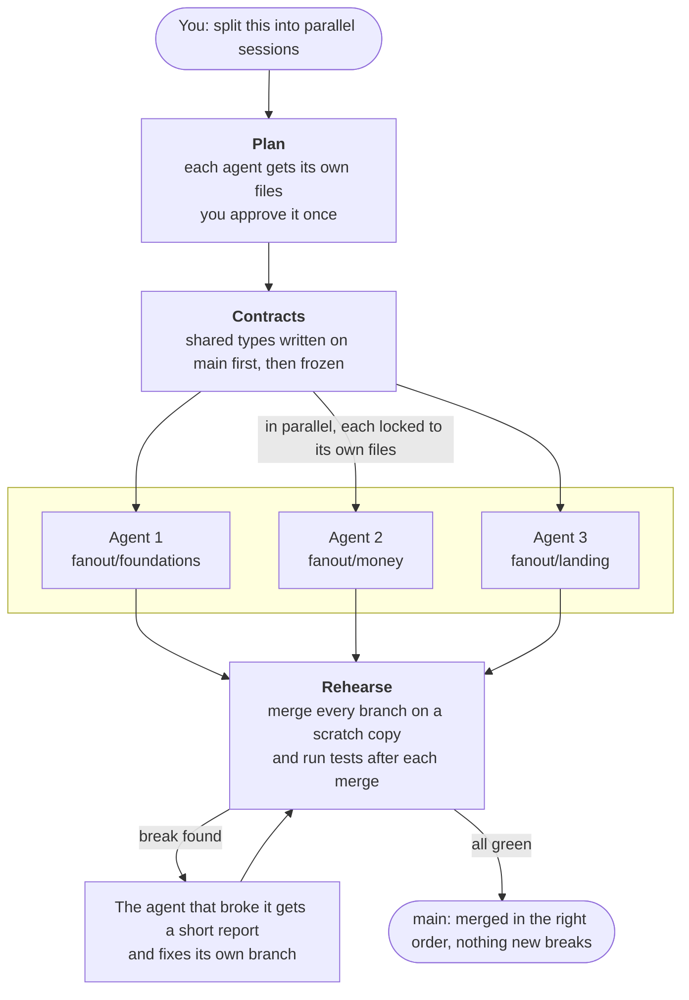

# fanout

**Run several coding agents at once. Merge once. Nothing breaks.**

Works with **Claude Code** and **Codex**, or a mix of both. No dependencies, no config, just Node 18+ and git.

---

## Why

Running agents in parallel is easy. Putting their work back together is the hard part:

- **Two agents edit the same file**, and one overwrites the other.
- **One agent renames a function another agent is calling.** Git merges both branches with no conflict, and the build breaks anyway.
- **Every agent regenerates the same file** (an API client, codegen output, a lockfile) and they all conflict.
- **You become the merge queue**, fixing breakages by hand after every round.

fanout stops each of these before it happens, and catches anything that slips through before it reaches `main`.

## How it works, in one picture



## Install

**Claude Code**

```
/plugin marketplace add Breadstick-Crumbs/fanout
/plugin install fanout@fanout
```

**Codex**

```bash
codex plugin marketplace add Breadstick-Crumbs/fanout
```

Then in Codex, open `/plugins` and install **fanout**, and open `/hooks` to trust its edit guard.

**Any other agent, or no plugin system**

```bash
git clone https://github.com/Breadstick-Crumbs/fanout
cp -r fanout/skills/fanout ~/.agents/skills/     # Codex reads skills from here
cp -r fanout/skills/fanout ~/.claude/skills/     # Claude Code reads skills from here
```

The git hook (below) enforces the rules whatever agent you use.

## Use

Ask your agent:

> Split this into parallel sessions: add Arabic support, fix the currency bug, and redo the landing page.

Then:

1. **It shows you a plan**: who owns which files, and the merge order. You say yes. That's the only time you're asked.
2. **Shared interfaces are written first** (types, function signatures) and committed, so every agent builds against the real thing instead of guessing.
3. **Each agent starts** on its own branch, in its own folder. If it tries to edit a file it doesn't own, it's stopped and told to ask.
4. **When they finish, fanout rehearses**: it merges every branch on a scratch copy and runs your tests after each merge. If something breaks, the agent that broke it gets a short report and fixes it.
5. **Everything merges into `main`** in the right order.

You only hear about problems if the same agent fails twice.

## The plan

Your agent writes it to `.fanout/plan.md`. You just read and approve it.

```md
test: npm test
regen: src/gen/** via npm run codegen

## foundations
owns: src/lib/types.ts, src/server/db/**
exposes: src/lib/types.ts
done: per-country visibility works; typecheck passes

## money
owns: src/lib/present.ts, src/components/MatchCard.tsx
uses: src/lib/types.ts
done: no hard-coded currency left
```

| Field | Meaning |
|---|---|
| `## name` | One session (one agent, one branch: `fanout/name`). |
| `owns` | The only files this session may change. Globs work. No two sessions may own the same file. |
| `exposes` | Files other sessions depend on (types, APIs). Written on `main` first, then frozen for everyone. |
| `uses` | Contracts this session depends on. It merges after the session that exposes them. |
| `after` | Extra merge-order dependencies, if you need them. |
| `done` | What finished looks like. |
| `test` | Your test command. Run after every merge during rehearsal. |
| `regen` | Generated files nobody owns, and the command that rebuilds them after merging. |

## What it catches

| Problem | What fanout does |
|---|---|
| Two sessions planned to own the same file | `check` refuses the plan: `CLASH a <-> b: src/x.ts` |
| A session edits a file it doesn't own | Blocked as it happens. The agent is told to ask. |
| A session changes a shared interface | Blocked. Interfaces are frozen during the fan-out. |
| A session edits a generated file | Blocked. It's rebuilt after merging instead. |
| Branches merge cleanly but break together | `rehearse` reports `BROKE after money` with the failing output. |
| A real merge conflict | `rehearse` reports `CONFLICT merging b: x.txt` before anything reaches `main`. |
| An agent with no hooks (Cursor, scripts) | The git pre-commit hook refuses the commit. |

## Commands

Your agent runs these. You can too.

```bash
node skills/fanout/fanout.mjs check              # is the plan safe? prints the merge order
node skills/fanout/fanout.mjs verify             # in a session's folder: anything changed outside its lane?
node skills/fanout/fanout.mjs rehearse           # merge every branch on a scratch copy, test after each
node skills/fanout/fanout.mjs install-git-hook   # enforce the plan on every commit, from any agent
```

## FAQ

**Do I need to configure anything?**
No. The plan is the only file, and your agent writes it.

**Does it get in the way of my normal work?**
No. Everything only acts on branches named `fanout/*`. On any other branch, fanout does nothing.

**Will it burn tokens?**
No. The checks are plain scripts with no AI calls. Agents are told to read only the files they need, and a failure report is a few lines, not a full log.

**Can I mix Claude Code and Codex?**
Yes. Sessions are just git branches. Run some in Claude, some in Codex, or headless (`claude -p`, `codex exec`).

**What if two tasks really need the same file?**
Give it to one session. If it's an interface others depend on, make it a contract (`exposes` / `uses`). If it's generated, list it under `regen`.

**What doesn't it do?**
It isn't a CI system. It won't fix flaky tests or speed up a slow test suite. It makes sure what your agents hand to CI already works together.

## Development

```bash
npm test
```

Node's built-in test runner. No dependencies.

## License

MIT. See [LICENSE](LICENSE).
